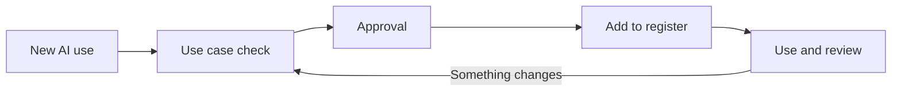

# AI Governance Starter Kit

A small set of templates for companies that are starting to use AI at work and need a simple way to manage the risks.
It follows the [NIST AI Risk Management Framework (AI RMF 1.0)](https://doi.org/10.6028/NIST.AI.100-1).

This is a personal project. It isn't affiliated with or endorsed by NIST or my employer, and it isn't legal advice.

## Why I made this
I'm exploring the idea of starting a software house in Manila, and I wanted a simple way to manage AI use from day one. This kit is what I'd use to start, and I'm sharing it so other small teams can use it too.

## How it's set up
There are four core templates. Each one fits on a page. You can start with these and add the others later if you need them.

The templates don't name any AI model or vendor, so you don't have to rewrite them when your tools change.
Everything is in Markdown, so you can edit or delete whatever doesn't fit your company.

## Core templates
| Step | Template | Use it for |
|---|---|---|
| 1 | [AI use policy](core/1-ai-use-policy.md) | Rules on what staff can do with AI, what needs approval and what isn't allowed |
| 2 | [AI use case check](core/2-ai-use-case-check.md) | Describing, rating and approving a new AI use case |
| 3 | [AI register](core/3-ai-register.md) | Keeping one list of the AI tools in use, who owns them and when to review them |
| 4 | [AI incident steps](core/4-ai-incident-steps.md) | Knowing what to do when something goes wrong |

To start, fill in the parts in `[brackets]`, remove anything you don't need, and share the policy with your team.

## Optional templates
The [grow](grow/README.md) folder has four more templates: a test plan, generative AI risk checks, metrics and roles.
Each one explains when it's worth adding.

## When AI tools change
You don't need to update the kit every time a new model comes out. Run the [AI use case check](core/2-ai-use-case-check.md) again when:
- You switch to a different model or vendor
- The tool starts using different data
- The purpose or the users change
- There's been an incident
- A law or company rule changes

## Other files
- [NIST mapping](reference/nist-mapping.md) shows which parts of the NIST framework each template relates to.
- [Example](reference/example.md) shows a filled-in use case check for a made-up company.
- [Sources](SOURCES.md) and [Changelog](CHANGELOG.md)

## License
[CC BY 4.0](https://creativecommons.org/licenses/by/4.0/). The NIST material referenced here isn't covered by this license, since US government works aren't under copyright in the United States.

## Author
Morris Martin Bongas · [[LinkedIn link]](https://www.linkedin.com/in/morris-martin-b-94487242/)
