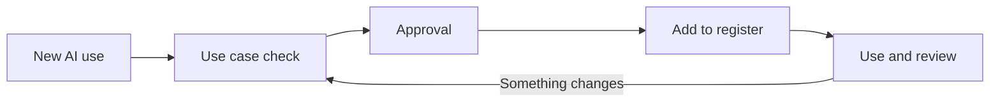

# Small Team AI Governance Kit

Simple templates for new and small companies that are starting to use AI at work and need an easy way to manage the risks.
Based on the [NIST AI Risk Management Framework (AI RMF 1.0)](https://doi.org/10.6028/NIST.AI.100-1).

This is a personal project. It isn't affiliated with or endorsed by NIST or my employer, and it isn't legal advice.

## Why I made this
I'm exploring the idea of starting a software house in Manila, and I wanted a simple way to manage AI use from day one. This kit is what I'd use to start, and I'm sharing it so other small teams can use it too.

## Who it's for
- Startups and small companies that are starting to use AI tools
- Team leads who need clear rules without a big governance program
- Anyone who wants a starting point they can change as they grow

## How to start
1. Click **Use this template** at the top of this page, or download the files as a ZIP.
2. Fill in the parts in `[brackets]` and remove anything that doesn't fit your company.
3. Share the [AI use policy](core/1-ai-use-policy.md) with your team.
4. List the AI tools you already use in the [AI register](core/3-ai-register.md).
5. Use the [AI use case check](core/2-ai-use-case-check.md) for every new AI use.

## Core templates
Each of these fits on one page.

| Step | Template | Use it for |
|---|---|---|
| 1 | [AI use policy](core/1-ai-use-policy.md) | Rules on what staff can do with AI, what needs approval and what isn't allowed |
| 2 | [AI use case check](core/2-ai-use-case-check.md) | Describing, rating and approving a new AI use case |
| 3 | [AI register](core/3-ai-register.md) | Keeping one list of the AI tools in use, who owns them and when to review them |
| 4 | [AI incident steps](core/4-ai-incident-steps.md) | Knowing what to do when something goes wrong |

## Optional templates
Add these later, when you need them. The [grow](grow/README.md) folder explains when each one is worth adding.

| Template | Worth adding when |
|---|---|
| [Test plan](grow/test-plan.md) | AI output reaches customers or affects decisions |
| [Generative AI risk checks](grow/genai-risks.md) | You build features with chatbots or text or image generators |
| [Metrics](grow/metrics.md) | You need to show whether AI is working and safe over time |
| [Roles](grow/roles.md) | Several teams use AI and it's unclear who approves what |

## When AI tools change
The templates don't name any AI model or vendor, so you don't need to rewrite them when a new model comes out.
Instead, run the [AI use case check](core/2-ai-use-case-check.md) again when:
- You switch to a different model or vendor
- The tool starts using different data
- The purpose or the users change
- There's been an incident
- A law or company rule changes

## Other files
- [NIST mapping](reference/nist-mapping.md): which parts of the NIST framework each template relates to
- [Example](reference/example.md): a filled-in use case check for a made-up company
- [Sources](SOURCES.md) and [Changelog](CHANGELOG.md)

## Feedback
If you use this kit or have ideas to improve it, please open an issue. I'd like to hear what worked and what didn't.

## License
[CC BY 4.0](https://creativecommons.org/licenses/by/4.0/). You can use and change these templates, including for commercial use, as long as you credit the source.
The NIST material referenced here isn't covered by this license, since US government works aren't under copyright in the United States.

## Author
Morris Martin Bongas · [LinkedIn](https://www.linkedin.com/in/morris-martin-b-94487242/)
